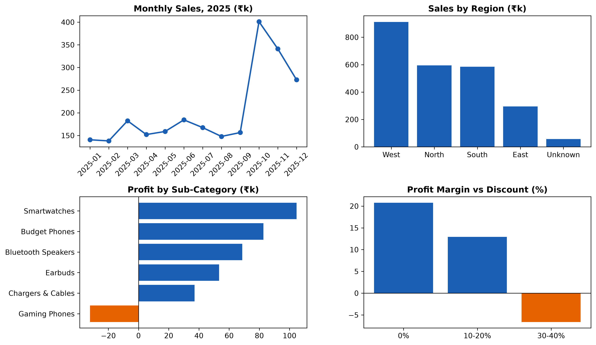

# Electronics & Gadgets Retail Profitability Analysis

## 📌 Business Problem
A consumer electronics retailer sells Smartphones, Audio, and Accessories across four Indian regions. While overall revenue looks steady at **2M**, net profit margins are being squeezed by heavy promotional discounts and underperforming product lines. Management wants to identify where profit is leaking and establish clear pricing and discount guardrails.

---

## 📊 Dashboard Preview

---

## 🛠️ Tools & Skills Used
* **Microsoft Excel:** Data cleaning, handling missing/unknown region values, and standardizing formats.
* **SQL:** Exploratory data analysis, margin calculations, and regional performance aggregations.
* **Microsoft Power BI:** Interactive dashboard design, DAX measures, KPI cards, and dynamic slicers (Category, Segment, Region).

---

## 🔍 Key Insights
1. **Top-Line Summary:** Generated **2M in Total Sales** and **314K in Profit** across **192 total orders**.
2. **Festive Season Surge:** Monthly sales remain flat (~0.14M–0.18M) from January to September before peaking sharply in **October (~0.40M)**.
3. **Regional Performance:** The **West region** dominates revenue (~0.91M), outperforming North (~0.59M), South (~0.58M), and East (~0.29M).
4. **Profit Drivers vs. Loss Makers:** **Smartwatches** (>100K profit) and **Budget Phones** (~82K profit) are the most profitable sub-categories, while **Gaming Phones** incur a net loss of **~30K**.
5. **Discount Erosion:** Margins remain healthy at **0%–10% discounts**, barely break even at **20%**, and turn **negative at 30%–40% discounts**.

---

## 💡 Business Recommendations
* **Cap Promotional Discounts:** Set a strict discount guardrail of **15%–20% maximum** across categories to prevent negative-margin orders.
* **Re-evaluate Gaming Phones:** Audit supplier costs, bundle structures, and discounting strategies for Gaming Phones to eliminate the ~30K profit leak.
* **Capitalize on Q4 Momentum:** Increase inventory allocation and targeted marketing in the **West, North, and South** regions ahead of the October festive peak.
* **Data Hygiene:** Fix tracking gaps causing **"Unknown"** region entries in sales records to improve regional reporting accuracy.

---

## 📂 Repository Structure
* `data/` — Cleaned retail dataset used for modeling.
* `powerbi/` — Interactive `.pbix` Power BI dashboard file.
* `sql/` — SQL queries used for data validation and KPI checks.
* `images/` — High-resolution dashboard screenshots.

